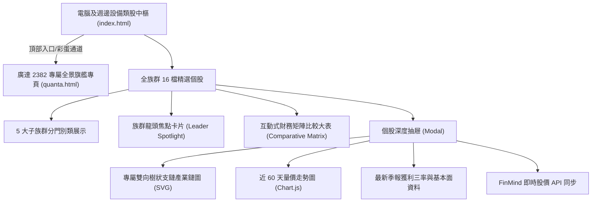

# 台灣電腦及週邊設備類股與廣達 AI 產業鏈中樞 —— 專案全景交接記憶檔 (Project Memory & Handover)

> **產生時間**：2026-11-26  
> **專案狀態**：已完成全部核心功能開發並成功部署上線  
> **適用對象**：接手的 AI 助手（如 Claude）、開發者或專案維護人員

---

## 1. 專案核心基本資訊

- **本地工作目錄**：`c:\Users\User\Desktop\0923\quanta-ai-supply-chain`
- **GitHub 儲存庫**：`https://github.com/itachi923/quanta-ai-supply-chain.git`
- **主要分支**：`main`
- **GitHub Pages 線上展示網址**：
  - 💻 **首頁（電腦及週邊設備類股中樞）**：[https://itachi923.github.io/quanta-ai-supply-chain/](https://itachi923.github.io/quanta-ai-supply-chain/)
  - 🤖 **廣達旗艦專頁（廣達 2382 全景深度研究）**：[https://itachi923.github.io/quanta-ai-supply-chain/quanta.html](https://itachi923.github.io/quanta-ai-supply-chain/quanta.html)

---

## 2. 專案背景與架構全景

本專案旨在打造台灣加權指數 **「電腦及週邊設備類股（TWSE 04）」** 的權威級產業鏈地圖與投資分析中樞，以純前端（HTML5 / 原生 CSS / 原生 JavaScript / SVG / Chart.js）打造，零後端依賴，完全託管於 GitHub Pages。

### 雙核心頁面體系：



1. **`index.html`（電腦及週邊設備類股中樞）**：
   - **全球戰略地位看板**：四大全球制霸數據（AI伺服器代工 >90%、筆電製造 >80%、導軌專利 >80%、水冷模組全球首位）與台灣代工演進史。
   - **5 大子族群分門別類**：
     1. `odm`：AI 伺服器整機與系統代工（廣達、鴻海、緯創、緯穎、英業達、和碩）
     2. `components`：伺服器關鍵零組件與散熱（奇鋐、雙鴻、川湖、勤誠）
     3. `ipc_iot`：工業電腦與邊緣物聯網（研華、樺漢）
     4. `brand_pc`：電腦品牌與電競旗艦（華碩、微星）
     5. `peripherals`：週邊設備與智慧顯示（佳世達、致伸）
   - **族群領軍龍頭（Bellwether）焦點卡片**：廣達（2382，代工龍頭）、川湖（2059，導軌霸主）、奇鋐（3017，散熱總冠軍）、研華（2395，工控龍頭）、華碩（2357，品牌旗艦）。
   - **多維度財務矩陣比較大表**：支援依股號、族群、股價、漲跌幅、近四季 EPS、單季營收、毛利率、營業利益率、ROE 即時點擊排序與子族群篩選。
   - **個股深度彈窗（Modal）**：點選 16 檔任一檔股票，即展開**該股專屬的雙向樹狀支鏈產業鏈圖**、近 60 天歷史量價線圖、財務指標，並即時連線更新。

2. **`quanta.html`（廣達 2382 旗艦專頁）**：
   - **頂部動態 Ticker**：即時股價、漲跌點數、漲跌幅、本益比、成交量、成交金額、總市值。
   - **章節 1：基本資料與產品營收拆解**：林百里/梁次震創辦、華亞園區總部、QCT 雲達白牌直供模式；AI伺服器(55%)、筆電(32%)、車用電子(9%)、智慧醫療(4%)。
   - **章節 2：700+ 個交易日歷史日線與均線**：Chart.js 雙軸走勢圖，支援近1個月、3個月、6個月、1年、全週期過濾，自動計算 MA20 月線與 MA60 季線。
   - **章節 3：最新財報基本面與獲利三率**：單季突破 1.1 兆元、累計四季度 EPS 突破 25.76 元、歷年營收/EPS長條圖、獲利三率（毛利率 8.72%、營益率 5.25%、淨利率 4.40%）三率三升折線圖。
   - **章節 4：AI 伺服器機櫃 BOM 表成本結構**：運算模組(GPU/CPU 68%)、水冷散熱(12%)、高階電源(7%)、高多層PCB/CCL(5%)、專利導軌機箱(4%)、高速纜線(4%)。
   - **章節 5：全景樹狀支鏈產業鏈拓撲圖**：五層橫向雙向拓撲（上游葉子 11 家 -> 上游模組 6 大類 -> 中游 6 大代工廠 -> 下游 2 大應用 -> 下游 CSP 與終端巨頭 6 家），支援縮放平移、節點高亮關聯路徑、側欄 Inspector 詳解。

---

## 3. 專案檔案結構

```
c:\Users\User\Desktop\0923\quanta-ai-supply-chain\
├── index.html                      # 主頁：電腦及週邊設備類股中樞 (約 92 KB)
├── quanta.html                     # 旗艦專頁：廣達 (2382) 深度基本面與拓撲圖 (約 77 KB)
├── README.md                       # 專案說明文件
├── PROJECT_MEMORY.md               # 本交接記憶檔
├── data/
│   ├── quanta_latest.json          # 廣達 700+ 筆歷史量價快取 (2024~最新)
│   └── sector_stocks.json          # 16 檔精選股票完整資料庫（基本面、產業鏈樹狀節點、60天日線）
└── scripts/
    ├── build_sector_data.py        # 建構/更新 16 檔類股資料庫腳本 (串接證券 API)
    ├── enrich_tree_chains.py       # 為 16 檔個股注入精緻專屬產業鏈拓撲資料
    ├── update_sector_subgroups.py  # 更新 5 大子族群分組與龍頭標記
    └── update_stock.py             # 更新廣達最新日線資料
```

---

## 4. 關鍵技術架構與避坑防護 (Crucial Technical Notes)

接手開發時，請**務必遵守**以下已驗證的重要工程規範：

### 1) 數字與幣別絕不換行（No-Wrap & Non-Breaking Space）
- **痛點**：之前在卡片或表格中，`NT$` 與數字（如 `44.35`）會因為容器壓縮被自動斷行成上下兩行。
- **解法規範**：
  - CSS 中所有涉及價格與金額的元素皆設定 `white-space: nowrap !important; word-break: keep-all; flex-shrink: 0;`。
  - JS 模板字串中一律使用 `NT$&nbsp;${price}` 與 `${symbol}${spread}&nbsp;(${pct}%)`，不可使用一般空格。

### 2) SVG 樹狀支鏈圖文字寬度自適應（Anti-Overflow Engine）
- **痛點**：節點文字過長（如「高階PCB與材料」或公司代號）容易超出矩形框框。
- **解法規範**：
  - 在繪製 SVG text 前，呼叫 `getFittedFontSize(text, maxWidth, defaultSize)` 動態測算文字寬度並調整字號（下限 9px），確保文字永不超出節點外框。
  - 連接線一律使用平滑三次方貝茲曲線（Cubic Bézier Curve: `M x1 y1 C ... x2 y2`），靜態高亮無重繪抖動。

### 3) 即時股價雙重保險架構（FinMind API + 本地快取）
- **API 端點**：`https://api.finmindtrade.com/api/v4/data?dataset=TaiwanStockPrice&data_id=${id}&start_date=...`
- **特性**：
  - 開放 CORS（`Access-Control-Allow-Origin: *`），前端瀏覽器可直連，不需要後端伺服器。
  - **首屏秒開**：直接從 `data/sector_stocks.json` 與 `data/quanta_latest.json` 渲染，零等待。
  - **背景即時同步**：`DOMContentLoaded` 時於背景非同步並行抓取，完成後平滑替換，並設定 `setInterval(..., 60000)` 每 60 秒輪詢一次。
  - **單股深度同步**：使用者點擊任意股票開啟彈窗時，觸發 `syncSingleStockLive(stockId)` 拉取該股最新 60 天完整走勢並重繪線圖。

### 4) Git 與 GitHub Pages 發布工作流
- 遠端遠址：`https://github.com/itachi923/quanta-ai-supply-chain.git`
- 只要推送至 `main` 分支，GitHub Actions 會在約 30~60 秒內自動建置並部署至 GitHub Pages。

---

## 5. 歷史需求與疊代歷程清單 (User Requests History)

1. **最初需求**：做一個以廣達為核心的網站，呈現廣達產業上下游供應鏈。
2. **形式調整**：要求改為「樹狀支鏈圖」，點擊任一廠商可清晰查看整個產業鏈上下游。
3. **體驗優化**：
   - 解決滑鼠懸停節點時畫面劇烈抖動的問題（改為純 CSS transition 靜態高亮）。
   - 修正「高階PCB與材料」文字超出外框的問題（導入字體動態適配縮放）。
   - 在中游將與廣達同性質的代工同業（鴻海、緯創、緯穎、英業達、技嘉）一併完整列出。
4. **廣達深度旗艦化**：加入廣達公司簡介、創辦人、核心產品結構（AI機櫃佔55%）、股價、歷史量價線圖、最新財報獲利三率三升分析。
5. **數據真實與每日更新**：串接台灣證券資料庫真實數據（收錄 700+ 個交易日完整日線），支援每日自動更新最新收盤價與均線。
6. **升級為類股中樞門戶**：將網站擴大為「電腦及週邊設備類股」，首頁展示 16 檔核心個股列表、簡介、即時股價、專屬上下游與財報，並在頂部設置一鍵直達廣達旗艦專頁的按鈕。
7. **全個股產業鏈一致化**：要求 16 檔股票點進去的彈窗，上下游產業鏈圖必須做得跟廣達一樣精緻（皆為雙向樹狀拓撲圖）。
8. **文字超出外框全面修正**：對全部 16 檔個股彈窗產業鏈圖進行節點寬度與字體自適應調整，徹底解決溢出問題。
9. **深度族群導航與比較矩陣**：
   - 最上方加入類股詳細介紹與全球戰略地位四大數據。
   - 將 16 檔股票細分為 5 大子族群分門別類展示。
   - 新增族群領軍龍頭（Bellwether）焦點卡片（標記廣達、川湖、奇鋐、研華、華碩為何是龍頭）。
   - 新增互動式財務指標綜合比較大表（支援排序、篩選、毛利高低顏色高亮）。
10. **數字跑版與全即時連線**：
    - 徹底修正截圖中 `NT$` 與價格斷成兩行的跑版 bug。
    - 實現每一檔股票點進去線圖與股價均為最新，並配置即時自動更新與 60 秒定時輪詢功能。

---

## 6. 後續可考慮之擴充建議 (Roadmap Ideas)

若使用者後續提出新需求，接手助手可參考以下方向：
1. **籌碼面分析**：外資、投信三大法人買賣超數據與持股比例圖表。
2. **K 線型態切換**：在 Chart.js 或引進 Lightweight Charts 支援「蠟燭 K 線圖 + 成交量」。
3. **匯出功能**：將個股產業鏈拓撲圖匯出為 PNG / SVG 圖片供報告使用。
4. **類股指數大盤對照**：加入「電腦及週邊設備指數（IX0026）」與大盤加權指數的強弱度對比走勢。
