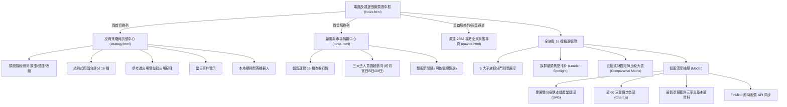

# 台灣電腦及週邊設備類股與廣達 AI 產業鏈中樞 —— 專案全景交接記憶檔 (Project Memory & Handover)

> **產生時間**：2026-11-26  
> **最後更新**：2026-11-27（新增投資策略與訊號頁 strategy.html：規則式評分、進出場價位、事件警示、本地問答機器人）  
> **專案狀態**：已完成全部核心功能開發並成功部署上線  
> **適用對象**：接手的 AI 助手（如 Claude）、開發者或專案維護人員

---

## 0. 給接手的 AI：先讀這 3 分鐘

### 這是什麼

台股「電腦及週邊設備類股（TWSE 04）」的產業鏈與投資分析網站。
**純前端**（HTML + 原生 JS + Chart.js + SVG），**零後端**，部署在 GitHub Pages。
資料以靜態 JSON 存在 repo 裡，由排程腳本每日更新後提交。

| 頁面 | 檔案 | 網址 |
|---|---|---|
| 類股中樞 | `index.html` | https://itachi923.github.io/quanta-ai-supply-chain/ |
| 投資策略與訊號 | `strategy.html` | https://itachi923.github.io/quanta-ai-supply-chain/strategy.html |
| 新聞與市場情報 | `news.html` | https://itachi923.github.io/quanta-ai-supply-chain/news.html |
| 廣達 2382 專頁 | `quanta.html` | https://itachi923.github.io/quanta-ai-supply-chain/quanta.html |

四頁以頁首切換列互通（`.page-tabs` / `.page-tab`，**四個檔案各有一份，改動要同步**；
`news.html` 的頁尾 `.footer-links` 還有第五份連結列）。

### 現在的狀態（2026-11-27）

- 功能全部完成：產業鏈樹狀圖、K 線切換、籌碼面三大法人、類股指數對照、新聞牆、還原股價
- **投資策略與訊號頁（2026-11-27 新增）**：規則式四面向評分、參考進出場價位、
  當日事件警示、未來波動區間、本地規則問答機器人（見第 7 章）
- 資料更新由 **Windows 本機排程** 負責（`QuantaSectorSite-DailyUpdate`，每日 17:15）
- GitHub Actions 的排程 **不可用**（見 3-6），workflow 保留為手動備援

### 更新全部資料（最常用的一行）

```powershell
powershell -ExecutionPolicy Bypass -File scripts\daily_update.ps1
```

會依相依順序跑完六支腳本、只在有變動時提交推送，紀錄寫在 `logs/`（已 gitignore）。

### 最重要的五個坑（全部實際踩過，細節見對應章節）

| # | 坑 | 後果 | 章節 |
|---|---|---|---|
| 1 | **FinMind 沒有即時報價** —— `TaiwanStockPrice` 只有日線收盤，盤中查當日回空陣列 | 網站曾長期顯示前一日收盤卻標成「即時」 | 3 |
| 2 | **原始股價未還原**，且前端即時同步會用原始資料**覆蓋**已還原的 history | K 線出現 -66% 假跳空；資料層修好了顯示層又還原回去 | 3-1, 3-2 |
| 3 | **腳本整份覆寫 JSON 會洗掉事後注入的欄位** —— `treeChain` 不在 `STOCKS_CONFIG` 裡 | 跑一次更新，16 檔樹狀圖**無聲消失** | 6 |
| 4 | **抓取失敗被記成「已抓過」** —— 空清單無法區分「沒資料」與「被限流」 | 被限流的個股新聞**永久遺失**，且無任何徵兆 | 3-4 |
| 5 | **PowerShell 5.1 需要 UTF-8 BOM** | 中文錯亂導致 .ps1 語法錯誤，**連日誌都產生不出來** | 3-6 |
| 6 | **訊號頁是「投資建議」性質的輸出** —— 任何數字錯誤都可能讓人真的賠錢 | 比視覺 bug 嚴重得多，且同樣是無聲的 | 7 |

共通教訓：**這個專案最危險的錯誤都是「無聲」的** —— 不會報錯，只會顯示錯的東西。
改完任何資料管線，一定要實際開瀏覽器看畫面，不要只看檔案。

### 絕對不要做的事

- **不要宣稱任何資料是「即時」**。全站都是每日收盤資料，頁面必須標出實際資料日期（見 3-5）。
- **不要用雙數值軸畫圖**。尺度差很多的兩個序列要指數化到同一基準（見 3-3、4）。
- **不要讓多來源後備用固定優先序**。要比較資料本身的時間戳，否則停更的來源會蓋掉新資料（見 3）。
- **不要在 `display:none` 的容器裡建立 Chart.js 圖表**（寬度為 0，見 5）。
- **不要直接 `json.dump` 覆寫 `data/*.json`**，先合併既有欄位（見 6）。
- **不要把 strategy.html 的措辭改成斷言式的投資建議**（「必漲」「保證」「建議買進」）。
  全站一律用「規則判定」「條件成立」「參考價位」，且免責聲明必須留在頁面最上方（見 7）。
- **不要在 strategy.html 裡放任何 API 金鑰**。它是公開靜態頁，金鑰等同公開（見 7-3）。

### 驗證清單（改完資料或圖表後照著跑）

1. 開瀏覽器實際看畫面，不要只看 JSON
2. 個股彈窗的 `modalHistory` 最大單日跳動 **不得超過 ±10%**（台股漲跌停），超過代表還原沒生效
3. `document.documentElement.scrollWidth > clientWidth` 為真 = 有水平溢出（手機版常見）
4. `treeChain` 必須維持 16/16
5. Console 不應有錯誤（FinMind 限流造成的 CORS 錯誤除外，那是預期的退回快取行為）
6. 改過 `build_signals.py` 後，檢查每檔的 `stopPct` 是否都在 **-12% 以內**、
   `rr`（風險報酬比）是否落在合理範圍（約 0.7~2.5），以及 `holdDaysMin/Max`
   是否**每檔都不一樣** —— 全部相同代表目標價退化成純 ATR 倍數，壓力區判斷失效了（見 7-2）

---

## 1. 專案核心基本資訊

- **本地工作目錄**：`c:\Users\User\Desktop\0923\quanta-ai-supply-chain`
- **GitHub 儲存庫**：`https://github.com/itachi923/quanta-ai-supply-chain.git`
- **主要分支**：`main`
- **GitHub Pages 線上展示網址**：
  - 💻 **首頁（電腦及週邊設備類股中樞）**：[https://itachi923.github.io/quanta-ai-supply-chain/](https://itachi923.github.io/quanta-ai-supply-chain/)
  - 📰 **新聞與市場情報中心**：[https://itachi923.github.io/quanta-ai-supply-chain/news.html](https://itachi923.github.io/quanta-ai-supply-chain/news.html)
  - 🤖 **廣達旗艦專頁（廣達 2382 全景深度研究）**：[https://itachi923.github.io/quanta-ai-supply-chain/quanta.html](https://itachi923.github.io/quanta-ai-supply-chain/quanta.html)
- **自動更新**：Windows 工作排程器 `QuantaSectorSite-DailyUpdate`（每日 17:15，錯過會在下次開機補跑）

---

## 2. 專案背景與架構全景

本專案旨在打造台灣加權指數 **「電腦及週邊設備類股（TWSE 04）」** 的權威級產業鏈地圖與投資分析中樞，以純前端（HTML5 / 原生 CSS / 原生 JavaScript / SVG / Chart.js）打造，零後端依賴，完全託管於 GitHub Pages。

### 四頁體系（頁首切換列互通）：



1. **`index.html`（電腦及週邊設備類股中樞）**：
   - **全球戰略地位看板**：四大全球制霸數據（AI伺服器代工 >90%、筆電製造 >80%、導軌專利 >80%、水冷模組全球首位）與台灣代工演進史。
   - **5 大子族群分門別類**：
     1. `odm`：AI 伺服器整機與系統代工（廣達、鴻海、緯創、緯穎、英業達、和碩）
     2. `components`：伺服器關鍵零組件與散熱（奇鋐、雙鴻、川湖、勤誠）
     3. `ipc_iot`：工業電腦與邊緣物聯網（研華、樺漢）
     4. `brand_pc`：電腦品牌與電競旗艦（華碩、微星）
     5. `peripherals`：週邊設備與智慧顯示（佳世達、致伸）
   - **族群領軍龍頭（Bellwether）焦點卡片**：廣達（2382，代工龍頭）、川湖（2059，導軌霸主）、奇鋐（3017，散熱總冠軍）、研華（2395，工控龍頭）、華碩（2357，品牌旗艦）。
   - **多維度財務矩陣比較大表**：支援依股號、族群、股價、漲跌幅、近四季 EPS、單季營收、毛利率、營業利益率、ROE 即時點擊排序與子族群篩選。
   - **個股深度彈窗（Modal）**：點選 16 檔任一檔股票，即展開**該股專屬的雙向樹狀支鏈產業鏈圖**、近 60 天歷史量價線圖、財務指標，並即時連線更新。
   - **類股指數 vs 大盤強弱對照（深度導航 2）**：電腦及週邊設備類指數與大盤加權指數的
     資金輪動對照，含 4 張摘要卡、自動解讀、指數化走勢圖、相對強度 RS 圖與數據表格，
     支援近 1／3／6 個月與全區間切換。
   - **量價圖 K 線切換**：每檔個股彈窗的 60 日量價圖支援「收盤線圖 ⇄ K 線圖」切換，
     K 線模式疊加 MA20 月均線，價格面板與成交量面板上下分離（不使用雙軸），成交量柱色與 K 棒同步。
   - **籌碼面區塊（Institutional Chips）**：每檔個股彈窗下方附三大法人買賣超與外資持股分析 —— 6 張摘要數字卡、三大法人每日買賣超堆疊柱狀圖、外資持股比例走勢圖、可切換的數據表格，並支援近 20／40／60 日區間切換。

2. **`quanta.html`（廣達 2382 旗艦專頁）**：
   - **頂部動態 Ticker**：即時股價、漲跌點數、漲跌幅、本益比、成交量、成交金額、總市值。
   - **章節 1：基本資料與產品營收拆解**：林百里/梁次震創辦、華亞園區總部、QCT 雲達白牌直供模式；AI伺服器(55%)、筆電(32%)、車用電子(9%)、智慧醫療(4%)。
   - **章節 2：700+ 個交易日歷史日線與均線**：支援「收盤線圖 ⇄ K 線圖」切換，近1個月、3個月、6個月、1年、全週期過濾，自動計算 MA20 月線與 MA60 季線。
     價格面板與成交量面板上下分離（已於 2026-11-26 由雙軸改為雙面板），兩面板 Y 軸等寬以對齊日期軸。
   - **章節 3：最新財報基本面與獲利三率**：單季突破 1.1 兆元、累計四季度 EPS 突破 25.76 元、歷年營收/EPS長條圖、獲利三率（毛利率 8.72%、營益率 5.25%、淨利率 4.40%）三率三升折線圖。
   - **章節 4：全景樹狀支鏈產業鏈拓撲圖**：五層橫向雙向拓撲（上游葉子 11 家 -> 上游模組 6 大類 -> 中游 6 大代工廠 -> 下游 2 大應用 -> 下游 CSP 與終端巨頭 6 家），支援縮放平移、節點高亮關聯路徑、側欄 Inspector 詳解。
   - **章節 5：AI 伺服器機櫃 BOM 表成本結構**：運算模組(GPU/CPU 68%)、水冷散熱(12%)、高階電源(7%)、高多層PCB/CCL(5%)、專利導軌機箱(4%)、高速纜線(4%)。
   - **章節 6：籌碼面 —— 三大法人動向與外資持股結構**：6 張摘要數字卡、依實際數據自動生成的籌碼結構解讀（可辨識「外資提款、投信承接」等對作格局）、三大法人每日買賣超堆疊柱狀圖、外資持股比例走勢圖、數據表格，支援近 20／40／60／全區間（80 日）切換。
   - **章節 7：投資價值總評與催化劑**：四大上行催化劑與風險防範指引（原章節 6）。

3. **`strategy.html`（投資策略與訊號中心）**：見第 7 章完整說明。頁面由上而下是一條
   「先環境、再事件、最後個股」的決策動線：置頂免責聲明 → 資料日期列 →
   類股階段研判（擴張／整理／收縮）→ 當日事件警示 → 依風險屬性的條件成立名單 →
   全 16 檔評分總表 → 其餘個股訊號卡 → 方法論與已知限制；右下角常駐問答機器人。

---

## 3. 專案檔案結構

```
c:\Users\User\Desktop\0923\quanta-ai-supply-chain\
├── index.html                      # 主頁：電腦及週邊設備類股中樞
├── strategy.html                   # 投資策略與訊號中心（評分、進出場、事件警示、問答機器人，約 92 KB）
├── news.html                       # 新聞與市場情報中心（盤面速覽 + 三大法人 + 新聞牆）
├── quanta.html                     # 旗艦專頁：廣達 (2382) 深度基本面與拓撲圖 (約 77 KB)
├── README.md                       # 專案說明文件
├── PROJECT_MEMORY.md               # 本交接記憶檔
├── .gitignore                      # 忽略 desktop.ini / __pycache__ / .claude / logs
├── logs/                           # 本機排程執行紀錄（gitignore，不進版控）
├── .github/
│   └── workflows/
│       └── daily-data-update.yml   # 平日 14:10 與 17:10 更新全部資料（唯一的排程）
├── data/
│   ├── quanta_latest.json          # 廣達 700+ 筆歷史量價快取 (2024~最新)
│   ├── sector_stocks.json          # 16 檔精選股票完整資料庫（基本面、產業鏈樹狀節點、60天日線）
│   ├── institutional.json          # 16 檔近 80 個交易日三大法人買賣超 + 外資持股比例 (約 151 KB)
│   ├── realtime.json               # 16 檔每日收盤報價（證交所 MIS 13:30 收盤快照）
│   ├── index_compare.json          # 類股指數與大盤指數每日收盤（約 12 KB / 217 個交易日）
│   ├── news.json                   # 類股新聞滾動封存（最近 10 天，已跨個股與跨媒體去重）
│   └── signals.json                # 策略訊號：評分、進出場價位、事件警示、名詞詞典（約 136 KB）
└── scripts/
    ├── build_sector_data.py        # 建構/更新 16 檔類股資料庫腳本 (串接證券 API，已改為保留 treeChain)
    ├── build_institutional_data.py # 建構/更新 16 檔籌碼面資料庫（三大法人 + 外資持股）
    ├── fetch_realtime_quotes.py    # 抓證交所 MIS 收盤報價，產出 realtime.json
    ├── build_index_compare.py      # 抓類股指數與大盤指數（增量更新，產出 index_compare.json）
    ├── build_news.py               # 抓 16 檔相關新聞（滾動封存 + 兩層去重，產出 news.json）
    ├── build_signals.py            # 把上列 JSON 換算成策略訊號（不連網，必須排最後）
    ├── adjust_prices.py            # 還原股價：除權息（精確）+ 股票分割（啟發式後備）
    ├── enrich_tree_chains.py       # 為 16 檔個股注入精緻專屬產業鏈拓撲資料
    ├── update_sector_subgroups.py  # 更新 5 大子族群分組與龍頭標記
    ├── update_stock.py             # 更新廣達最新日線資料（同時提供交易日曆給指數腳本）
    └── daily_update.ps1            # 本機排程主腳本：依序跑完全部更新並提交推送
```

---

## 4. 關鍵技術架構與避坑防護 (Crucial Technical Notes)

接手開發時，請**務必遵守**以下已驗證的重要工程規範：

### 1) 數字與幣別絕不換行（No-Wrap & Non-Breaking Space）
- **痛點**：之前在卡片或表格中，`NT$` 與數字（如 `44.35`）會因為容器壓縮被自動斷行成上下兩行。
- **解法規範**：
  - CSS 中所有涉及價格與金額的元素皆設定 `white-space: nowrap !important; word-break: keep-all; flex-shrink: 0;`。
  - JS 模板字串中一律使用 `NT$&nbsp;${price}` 與 `${symbol}${spread}&nbsp;(${pct}%)`，不可使用一般空格。

### 2) SVG 樹狀支鏈圖文字寬度自適應（Anti-Overflow Engine）
- **痛點**：節點文字過長（如「高階PCB與材料」或公司代號）容易超出矩形框框。
- **解法規範**：
  - 在繪製 SVG text 前，呼叫 `getFittedFontSize(text, maxWidth, defaultSize)` 動態測算文字寬度並調整字號（下限 9px），確保文字永不超出節點外框。
  - 連接線一律使用平滑三次方貝茲曲線（Cubic Bézier Curve: `M x1 y1 C ... x2 y2`），靜態高亮無重繪抖動。

### 3) 報價架構：每日收盤制（重要，演進過兩次，都踩過坑）

> ⚠️ **先釐清一個曾經寫錯的觀念**：FinMind 的 `TaiwanStockPrice` **只有日線收盤資料，不是即時報價**。
> 盤中以當日日期查詢會回傳 **空陣列**。
> 2026-11-26 之前的版本到處寫「即時股價」，實際顯示的一直是 **前一交易日收盤價**。
> 當日 11:50 實測：網站顯示廣達 261.0（11/25 收盤），真實盤中價為 281.0。

- **真正的即時來源**：證交所 MIS `https://mis.twse.com.tw/stock/api/getStockInfo.jsp`
  - 支援一次批次查詢多檔：`ex_ch=tse_2382.tw|tse_3231.tw|...`
  - **3324 雙鴻為櫃買股，必須用 `otc_` 前綴**，用 `tse_` 會回傳空白紀錄。
  - **價格取值順序**：盤中逐筆撮合下頂層 `z` 多半是 `"-"`，必須依序退回
    `z` → `trade.z`（最近一筆成交價）→ `b` 委買首檔 → `o` 開盤價。
  - 其他欄位：`y` 昨收、`v` 累積成交張數、`u`/`w` 漲跌停價。MIS **不提供成交金額**，只能估算。
- **致命限制：MIS 不送 CORS 標頭**，瀏覽器從 GitHub Pages 直接呼叫一定被擋。
  Yahoo Finance 的 `query1.finance.yahoo.com` 同樣沒有 CORS 標頭；
  FinMind 的即時快照端點 `taiwan_stock_tick_snapshot` 需付費等級。
  **結論：沒有任何免費又支援 CORS 的台股即時 API 可供靜態網站直連。**
- **現行作法（2026-11-27 起）：每日收盤後更新一次，讀同源靜態檔**
  1. 排程（`.github/workflows/daily-data-update.yml`）在收盤後執行
     `scripts/fetch_realtime_quotes.py`，抓 MIS 的 13:30 收盤快照寫成 `data/realtime.json`。
  2. 連同其他資料一起提交回 `main`，前端直接讀 **同源** 的 `data/realtime.json`，
     完全不需要 CORS 繞道。
- **為什麼放棄盤中 5 分鐘更新**（曾經實作過，已移除）：
  1. 高頻 cron 最容易被 GitHub 降級或直接丟棄 —— 實測本 repo 的排程 **從未觸發過一次**
     （`schedule` 事件總數為 0，兩個 workflow 的執行紀錄全來自手動 `workflow_dispatch`）。
  2. 本站其餘資料（三大法人、指數、新聞、財報）本來就都是每日的，
     只有報價宣稱盤中，反而製造不一致的預期。
  3. 一天 80+ 次強制推送，為了 5 分鐘延遲的報價並不划算。
- **曾經的 `data-live` 分支作法已廢止**：原本用孤兒分支強制覆蓋推送快照，
  前端經 `raw.githubusercontent.com` 讀取（該網域確實有 `Access-Control-Allow-Origin: *`）。
  > ⚠️ **這個設計踩過一個無聲的坑**：前端無條件 **優先** 讀 `data-live`，
  > 一旦排程沒跑或推送失敗，停在舊日期的 `data-live` 會 **蓋掉 `main` 上較新的資料**。
  > 實測發生過：`data-live` 停在 11-26 13:30、`main` 已是 11-27 13:30，
  > 但三個頁面顯示的全是前一天的報價，且沒有任何錯誤提示。
  > 教訓：**多來源後備不能用固定優先序，要比較資料本身的時間戳**（或像現在這樣只留單一來源）。
- **誠實標示**：畫面顯示快照自帶的 `marketDate` / `marketTime`，
  文案寫「收盤價 2026-11-27 13:30:00（證交所 MIS）」，不寫「即時」。
- **首屏秒開仍然保留**：先用 `data/sector_stocks.json` 與 `data/quanta_latest.json`
  渲染日線與圖表，再以收盤快照覆寫價格欄位。

### 3-1) 還原股價（除權息 + 股票分割回溯調整）

- **痛點**：FinMind 與 TWSE 的原始價格皆為 **未還原**。個股一旦除權息或分割，
  K 線會出現假斷崖，均線、報酬率與漲跌幅全部失真。
- **實作**：`scripts/adjust_prices.py`（取代早期只處理分割的 `adjust_splits.py`）。
  **兩層機制，順序不可顛倒**：
  1. **除權息還原（精確）** —— 來源 FinMind `TaiwanStockDividend`（免 token）。
     有實際配息配股金額，可算出精確因子：
     ```
     配股率 r     = 股票股利 / 10          （台股面額 10 元）
     除權息參考價 = (前一交易日收盤 − 現金股利) / (1 + r)
     還原因子 f   = 參考價 / 前一交易日收盤
     ```
     事件日 **之前** 的 OHLC 乘上 f、成交量乘上 (1 + r)。
  2. **分割偵測（啟發式，後備）** —— 只在 **套用除權息還原之後** 仍有單日 ±25%
     以上跳空時才啟動，因為面額變更／股票分割不會出現在股利資料集裡。
- **所有因子必須先用「原始序列」一次算完再套用**，否則較早的事件會用到
  已被後面事件縮放過的價格，造成連鎖誤差。

> ⚠️ **一個曾經判斷錯誤的案例，留作教訓**
> 緯穎 (6669) 2026-09-02 由 7,800 跳到 2,610，早期版本的啟發式判定為
> 「1:3 股票分割、係數 **3.0**」。接上股利資料後才發現，那其實是
> **股票股利 19.8279 元的除權**，配股率 1.98279，精確係數為 **2.98279**。
> 啟發式猜的 3.0 有 **0.57% 誤差**，而且事件類型也標錯了。
> 教訓：有權威資料來源時就不要用數字去猜事件類型。

- **對照組**：**川湖 (2059)** 同期 14,340 → 6,505 **無單日斷點**，屬真實連續下跌，
  兩層機制都不會動它（只會套用它自己 2026-08-27 的現金股利 51 元，因子 0.996485）。
- **可追溯**：調整後寫入 `"priceAdjustments": [{"date","kind","factor","cash","stock"}]`
  （取代舊的 `splits` 欄位）。
- **先 dry-run 再套用**：`python scripts/adjust_prices.py` 只報告，加 `--apply` 才寫檔。
  日常則由 `build_sector_data.py` 與 `update_stock.py` 自動套用，重跑不會失效。

### 3-2) 前端必須重新套用還原因子（容易漏掉）

- **痛點**：本地 JSON 裡的 `history` 已經還原過，但 **即時同步會用 FinMind 的
  原始未還原日線覆寫它**，假斷崖就會整個跑回來。
  實測：緯穎彈窗 K 線最大單日跳動一度顯示 66.54%，而資料檔裡其實是 9.94%。
- **兩個覆寫點**：
  - `index.html` 的 `syncSingleStockLive()` → `stock.history = raw.map(...)`
  - `quanta.html` 的 `fetchLiveStockData()` → `rawDailyPrices = json.data`
- **解法**：兩頁都加入 `applyPriceAdjustments(rows, adjustments)`，
  對 API 取回的原始列重新套用一次因子（與 Python 端同一套邏輯）。
  因子來源是本地 JSON 的 `priceAdjustments` 欄位，所以 **本地快取要先載入成功**。
- **驗證方式**：開啟個股彈窗後檢查 `modalHistory` 的最大單日跳動，
  台股有漲跌停限制，**任何超過 ±10% 的單日跳動都代表還原沒生效**。

### 3-3) 類股指數 vs 大盤對照

- **資料來源**：證交所 MI_INDEX（每日收盤行情 - 類股指數）
  `https://www.twse.com.tw/rwd/zh/afterTrading/MI_INDEX?date=YYYYMMDD&type=IND&response=json`
  - **單次請求即同時含「發行量加權股價指數（大盤）」與「電腦及週邊設備類指數」**，不必分兩次抓。
  - 回應是新版的 `tables` 結構（不是舊的 `fields`/`data`），要走 `payload["tables"][*]["data"]`。
  - 非交易日回傳 `stat != "OK"`，直接略過即可。
- **為什麼不用 FinMind**：FinMind 只有大盤（`TaiwanStockPrice` 用 `data_id=TAIEX` 可取得，
  實測可行），**沒有任何類股指數**。`IX0026` 這個代碼在 FinMind 查不到資料。
- **TWSE 不送 CORS 標頭**，所以一律後端抓好寫成 JSON，前端讀同源靜態檔，
  與盤中報價快照同一套作法。
- **增量更新**：`scripts/build_index_compare.py` 會先讀既有 JSON，只補抓缺少的交易日；
  交易日曆直接取自 `quanta_latest.json` 的日線日期，不會把週末與休市日也打一遍。
  首次建立 217 個交易日約需 3 分鐘，之後每天只多抓一天。
- **自動更新**：`.github/workflows/daily-data-update.yml`，平日 UTC 06:10 與 09:10
  （台北 14:10、17:10）各執行一次並直接提交回 `main`。

- **圖表設計準則（這個功能的核心判斷）**：
  1. **絕不雙軸**。類股指數約 345 點、大盤約 38,000 點，尺度差了百倍。
     兩個 Y 軸的對齊位置是任意決定的，會做出資料裡根本不存在的相關性。
     一律 **指數化到「區間起點 = 100」** 後畫在同一個軸上，斜率高者即為資金流入方向。
  2. **相對強度 RS 另外成圖**。RS =（類股 ÷ 大盤）再指數化到 100，
     它回答的是「相對」問題，與絕對走勢不同，塞在同一張圖會混淆。
  3. 兩張圖都把 **100 那條基準線加深**（`grid.color` 用函式判斷 `tick.value === 100`），
     與籌碼面圖表的零軸處理一致。
  4. 類別色固定順序：類股 = 藍（slot 1）、大盤 = 橘（slot 2）；RS 單一序列用紫色。

> ⚠️ **窄螢幕水平溢出的常見來源**：`.chips-data-note` 設了 `white-space: nowrap`，
> 一旦說明文字變長（例如帶上來源網址）就會在手機撐出水平捲軸。
> 已在 media query 中放行換行，並縮短說明文字。
> **驗證方式**：`document.documentElement.scrollWidth > clientWidth` 為真就是有溢出；
> 要定位元凶，逐一比對各元素的 `getBoundingClientRect().right` 是否超出視窗寬度。

### 3-4) 新聞情報資料管線

- **資料來源**：FinMind `TaiwanStockNews`（免 token），欄位有 `date`（含時分秒）、
  `stock_id`、`title`、`link`、`source`。
- **兩個與直覺相反的 API 行為（實測得出，務必記住）**：
  1. **只會回傳 `start_date` 當天的新聞**，不是「該日之後的全部」。
  2. **加上 `end_date` 反而回傳 0 筆**。
  => 因此必須「逐檔 × 逐日」查詢，無法一次抓一段區間。
     16 檔 × 10 天 = 160 次請求，首次建立約需 2～3 分鐘。
- **滾動式封存**：`scripts/build_news.py` 只保留最近 `KEEP_DAYS`（目前 10）天，
  已抓過的 (個股, 日期) 不重抓，但 **當天一律重抓**（當日新聞會持續增加）。
  平時每日排程只需約 32 次請求。
- **兩層去重（缺一不可）**：
  1. **跨個股合併**：一篇同時提到廣達與緯創的報導會掛在兩檔底下，
     合併成一筆並記錄所有相關個股，前端顯示「相關個股」標籤。
  2. **跨媒體合併**：同一則報導常被多家媒體轉載，FinMind 的標題結尾會帶來源名
     （「神達董座：…… - 聚財網」「神達董座：…… - 自由時報」）。
     若不處理，新聞牆會連續出現好幾則只差結尾的重複標題（實測確實發生）。
     解法是 `normalize_title()` 去掉來源後綴後當鍵合併，並保留所有來源，
     前端顯示成「聚財網 等 3 家」。
     > 後備規則只在最後一段「 - xxx」長度 ≤ 12 字時才裁切，
     > 避免把標題本身含有破折號的內容誤砍。

### 3-5) 「即時」一詞的使用準則

各項資料的實際更新頻率不同，頁面上必須誠實標示，不可一律寫「即時」：

| 資料 | 實際頻率 | 頁面標示方式 |
|---|---|---|
| 個股報價 | **每日收盤後一次** | 寫「收盤價 YYYY-MM-DD 13:30:00（證交所 MIS）」 |
| 三大法人 | **收盤後才公布**（約 15:00-16:00） | 明寫「由證交所收盤後公布」並標資料日期 |
| 類股指數 | 每日收盤後 | 標示區間起訖日 |
| 新聞 | 每日排程（可手動補跑） | 標示更新時間與保留天數 |

**全站沒有任何盤中即時資料。** 盤中時段畫面顯示的是前一交易日收盤價，
這是刻意的取捨（見章節 3），但必須標示清楚，絕不可寫成「即時」。

### 3-6) 自動更新改用本機排程（GitHub Actions 排程不可用）

- **問題**：本 repo 的 GitHub Actions **排程從未觸發過一次**。
  `schedule` 事件總數為 0，兩個 workflow 的執行紀錄全部來自手動 `workflow_dispatch`。
- **已逐項排除**：workflow 檔案格式（純 LF、無 BOM、`on: schedule` 正確）、
  workflow 註冊狀態（`state=active`）、repo 設定（公開、非 fork、未封存、預設分支 main、
  Actions permissions 為 Allow all）、GitHub 服務狀態（Actions operational、無進行中事件）、
  卡住的排隊任務（queued / in_progress / waiting 皆為 0）。
  研判為 GitHub 端問題，可能與帳號較新（建立於 2026-09-30）有關，無法從外部驗證。
- **解法**：改由 Windows 工作排程器執行 `scripts/daily_update.ps1`。
  - 工作名稱：`QuantaSectorSite-DailyUpdate`，每日 17:15
  - 勾選 **StartWhenAvailable**：關機期間錯過的執行會在下次開機後自動補跑，
    所以電腦不需要整天開著（收盤價是固定的，晚幾小時抓結果一樣）
  - 以 **Interactive** 身分執行：git 憑證管理員需要使用者工作階段才能推送
  - GitHub Actions 的 `daily-data-update.yml` 保留為備援（手動觸發確定可用）

> ⚠️ **兩個 Windows 特有的坑，都實際踩過**
> 1. **PowerShell 5.1 需要 UTF-8 BOM**。沒有 BOM 時它以 ANSI(cp950) 讀取 .ps1，
>    中文註解會錯亂到連字串結尾都被打斷，腳本直接語法錯誤、連日誌都產生不出來。
>    存檔必須用 `utf-8-sig`。
> 2. **子程序輸出編碼**。要在腳本開頭設 `[Console]::OutputEncoding = [Text.Encoding]::UTF8`，
>    否則 Python 以 UTF-8 輸出的中文在日誌裡全是亂碼。
>
> 執行紀錄寫在 `logs/daily_update_YYYY-MM.log`（已 gitignore）。
> 手動執行：`powershell -ExecutionPolicy Bypass -File scripts\daily_update.ps1`

### 4) 籌碼面資料管線與圖表設計準則

- **資料來源**（FinMind，皆免 token、開放 CORS）：
  - `TaiwanStockInstitutionalInvestorsBuySell`：三大法人每日買賣張數
  - `TaiwanStockShareholding`：外資持股比例（`ForeignInvestmentSharesRatio`）
- **法人分類對應**（FinMind `name` 欄位 → 台股慣用三大法人）：
  - 外資 = `Foreign_Investor` + `Foreign_Dealer_Self`
  - 投信 = `Investment_Trust`
  - 自營商 = `Dealer_self` + `Dealer_Hedging`
  - 單位一律 **(buy − sell) ÷ 1000 = 張**，正數買超、負數賣超。
- **API 額度注意**：FinMind 免費額度有限，連續呼叫會回 `HTTP 402 Payment Required`（實為限流）。
  **注意**：被限流時的錯誤回應 **不帶 `Access-Control-Allow-Origin` 標頭**，因此瀏覽器 Console 會顯示成
  「blocked by CORS policy」而非 402 —— 這是限流的表徵，不是程式缺陷，頁面會自動回退本地快取照常顯示。
  `build_institutional_data.py` 已內建退避重試（最多 3 次，間隔遞增）與每次呼叫 1.2 秒間隔，
  前端則只在開啟彈窗時補抓「近 12 天」補尾，失敗一律 **靜默回退本地快取**，不影響其他區塊。
- **圖表設計準則（新增圖表時務必遵守）**：
  1. **絕不使用雙數值軸**。買賣超（張）與持股比例（%）各自獨立成圖——兩個尺度疊在同一張圖會製造出資料中不存在的假相關。
  2. **類別色固定順序、永不循環**：外資 `#2a78d6`（藍）、投信 `#eb6834`（橘）、自營商 `#1baf7a`（碧綠）。此三色已通過色盲安全性驗證。
  3. **顏色只承載「身分」**；多空方向由零軸上下位置與 ▲▼ 文字承載，絕不以顏色單獨表意。
  4. 髮絲實線格線（`#f1f5f9`，零軸 `#94a3b8` 略深），不使用虛線；堆疊段之間以表面色（白）描邊製造留白。
  5. 每張圖都有圖例或標題指名，並提供可切換的 **數據表格視圖**（不靠顏色與游標即可讀取每個數值）。
  6. 摘要數字卡使用 **比例數字**（`--font-main`），表格才用等寬數字（`tabular-nums`）。
  7. 區間濾鏡列統一置於所有圖表 **上方**，一次切換連動數字卡、兩張圖與表格。

### 5) K 線圖實作與 Chart.js 三個必踩的坑

- **K 棒不需要任何額外函式庫**：以 Chart.js 原生 **浮動長條** 繪製即可 ——
  影線 = `[最低, 最高]`、實體 = `[開盤, 收盤]`，兩個 dataset 皆設 `grouped: false` 使其疊在同一根 x 上。
  台股慣例：紅 K = 收盤 ≥ 開盤、綠 K = 收盤 < 開盤。
- **坑 1：bar 型態的 Y 軸預設含 0**。價格軸若不明確指定 `min` / `max`，
  Chart.js 會把 0 納入軸範圍，K 棒會被壓縮在圖表上方一小塊、完全看不出型態。
  解法：依資料的最高／最低價加約 6% 留白後，再依價位高低取整到合適級距
  （>500 用 50、>100 用 10、>20 用 5、>5 用 1、其餘 0.5），讓刻度是整齊數字。
- **坑 2：在 `display:none` 的容器中建立圖表，寬度為 0**。
  `openStockModal()` 必須 **先** 把彈窗設為 `display:flex`，**再** 呼叫繪圖函式，
  否則 K 棒會縮在畫布左上角一小塊。（樹狀圖的文字寬度測算同理需要元素可見。）
- **坑 3：靠 canvas 的 `height` 屬性維持長寬比，在手機寬度下會把面板壓扁**。
  成交量面板在 375px 寬時只剩約 40px，扣掉軸標籤後柱子幾乎消失。
  解法：容器固定高度 + `maintainAspectRatio: false`，並以 media query 調整
  （桌機 300/118、手機 230/100；彈窗為 260/96 與 220/92）。
- **十字線處理**：開盤 = 收盤時浮動長條高度為 0 會消失，需給予極小 epsilon 高度保留一條橫線。
- **對齊**：價格面板與成交量面板以 `afterFit` 固定相同的 Y 軸寬度，日期軸才會逐日對齊；
  日期刻度只在下方成交量面板顯示，價格面板設 `ticks.display: false`。

### 6) 資料腳本的破壞性寫入防護（重要）

- **痛點**：`build_sector_data.py` 原本是把內嵌的 `STOCKS_CONFIG` 整份 `json.dump` 覆寫 `sector_stocks.json`，
  但 `treeChain`（16 檔個股專屬樹狀產業鏈圖資料）是由 `enrich_tree_chains.py` **事後注入 json** 的，
  不存在於 `STOCKS_CONFIG` 裡。因此每跑一次更新報價，就會**無聲洗掉全部 16 檔的樹狀圖**。
- **解法規範**（已於 2026-11-26 修正）：
  1. 寫入前先讀回既有 `sector_stocks.json`，把設定檔沒有的欄位（`treeChain` 等）合併回來。
  2. 寫入前自我檢查，若任一檔缺少 `treeChain` 則**中止寫入**並提示先跑 `enrich_tree_chains.py`。
  3. 抓取失敗時沿用既有報價，絕不寫入空值。
- **接手守則**：任何「整份重寫 data/*.json」的腳本，都必須先合併既有欄位再寫入。

### 7) Git 與 GitHub Pages 發布工作流
- 遠端遠址：`https://github.com/itachi923/quanta-ai-supply-chain.git`
- 只要推送至 `main` 分支，GitHub Actions 會在約 30~60 秒內自動建置並部署至 GitHub Pages。

---

## 5. 歷史需求與疊代歷程清單 (User Requests History)

1. **最初需求**：做一個以廣達為核心的網站，呈現廣達產業上下游供應鏈。
2. **形式調整**：要求改為「樹狀支鏈圖」，點擊任一廠商可清晰查看整個產業鏈上下游。
3. **體驗優化**：
   - 解決滑鼠懸停節點時畫面劇烈抖動的問題（改為純 CSS transition 靜態高亮）。
   - 修正「高階PCB與材料」文字超出外框的問題（導入字體動態適配縮放）。
   - 在中游將與廣達同性質的代工同業（鴻海、緯創、緯穎、英業達、技嘉）一併完整列出。
4. **廣達深度旗艦化**：加入廣達公司簡介、創辦人、核心產品結構（AI機櫃佔55%）、股價、歷史量價線圖、最新財報獲利三率三升分析。
5. **數據真實與每日更新**：串接台灣證券資料庫真實數據（收錄 700+ 個交易日完整日線），支援每日自動更新最新收盤價與均線。
6. **升級為類股中樞門戶**：將網站擴大為「電腦及週邊設備類股」，首頁展示 16 檔核心個股列表、簡介、即時股價、專屬上下游與財報，並在頂部設置一鍵直達廣達旗艦專頁的按鈕。
7. **全個股產業鏈一致化**：要求 16 檔股票點進去的彈窗，上下游產業鏈圖必須做得跟廣達一樣精緻（皆為雙向樹狀拓撲圖）。
8. **文字超出外框全面修正**：對全部 16 檔個股彈窗產業鏈圖進行節點寬度與字體自適應調整，徹底解決溢出問題。
9. **深度族群導航與比較矩陣**：
   - 最上方加入類股詳細介紹與全球戰略地位四大數據。
   - 將 16 檔股票細分為 5 大子族群分門別類展示。
   - 新增族群領軍龍頭（Bellwether）焦點卡片（標記廣達、川湖、奇鋐、研華、華碩為何是龍頭）。
   - 新增互動式財務指標綜合比較大表（支援排序、篩選、毛利高低顏色高亮）。
17. **報價改為每日收盤制 + 本機排程接手**（最新）：
    - 使用者考量「不需要即時、只要每天更新到收盤價」且電腦無法整天開著，
      決定移除盤中 */5 排程與整套 data-live 分支機制。
    - 過程中發現前端無條件優先讀 data-live，一旦它停更就會蓋掉主分支較新的資料
      （實測三頁都顯示前一天報價卻無任何錯誤），已改為單一同源來源。
    - 查出 GitHub Actions 排程在本 repo 從未觸發過，逐項排除後研判為 GitHub 端問題，
      改以 Windows 工作排程器（StartWhenAvailable 補跑模式）負責每日更新。
    - 全站文案改為誠實標示「收盤價 YYYY-MM-DD 13:30:00」，不再出現「即時」。

16. **新聞與市場情報頁**：
    - 新增 `news.html`，彙整 16 檔的盤面速覽、三大法人買賣超與相關新聞。
    - 三頁（中樞／情報／廣達）頁首加入共用切換列。
    - 新聞來源 FinMind `TaiwanStockNews`，含跨個股與跨媒體兩層去重。
    - 每日排程擴充為同時更新指數、法人與新聞。

15. **類股指數 vs 大盤強弱對照**：
    - 接上證交所 MI_INDEX，單次請求同時取得大盤與類股指數，已累積 217 個交易日。
    - 首頁新增「深度導航 2」區塊：指數化走勢對照 + 相對強度 RS 圖 + 自動解讀。
    - 加入每日排程，平日收盤後自動補當天資料。

14. **除權息還原**：
    - 接上 FinMind `TaiwanStockDividend`，以實際配息配股金額計算精確還原因子。
    - 過程中發現緯穎那筆並非股票分割，而是股票股利 19.8279 元的除權，
      精確係數 2.98279（原啟發式猜的 3.0 有 0.57% 誤差）。
    - 另修正前端 bug：即時同步會用原始日線覆寫已還原的 history，
      需在前端重新套用因子。

13. **盤中即時報價與還原股價**：
    - 使用者回報股價與自行查詢不符 —— 查證後確認 FinMind 只有日線收盤，
      網站一直顯示前一交易日收盤價，「即時」是錯誤標示。
    - 改以證交所 MIS 為真實來源，透過 GitHub Actions + `data-live` 分支繞開 CORS。
    - 廣達專頁頂部 Ticker 與首頁 16 檔卡片／比較矩陣全部改為盤中報價。
    - 導入 `adjust_splits.py` 還原股價，修正緯穎 1:3 分割造成的假斷崖。

12. **K 線圖切換**：
    - `quanta.html` 章節 2 與 `index.html` 個股彈窗皆支援「收盤線圖 ⇄ K 線圖」切換。
    - 以 Chart.js 原生浮動長條繪製 K 棒，不引入任何新函式庫。
    - 量價圖由原本的雙軸改為「價格面板 + 成交量面板」上下分離，避免雙軸造成的假相關。

11. **籌碼面三大法人分析**：
    - 建立 `build_institutional_data.py` 抓取 16 檔個股近 80 個交易日的三大法人買賣超與外資持股比例。
    - `index.html` 每檔個股彈窗新增籌碼面區塊；`quanta.html` 新增章節 6 籌碼面專章（含自動數據解讀）。
    - 導入圖表設計準則：拆成兩張單軸圖（絕不雙軸）、類別色固定順序、附數據表格視圖。

10. **數字跑版與全即時連線**：
    - 徹底修正截圖中 `NT$` 與價格斷成兩行的跑版 bug。
    - 實現每一檔股票點進去線圖與股價均為最新，並配置即時自動更新與 60 秒定時輪詢功能。

---

## 6. 後續可考慮之擴充建議 (Roadmap Ideas)

若使用者後續提出新需求，接手助手可參考以下方向：
1. ~~**籌碼面分析**：外資、投信三大法人買賣超數據與持股比例圖表。~~ ✅ **已於 2026-11-26 完成**
2. ~~**K 線型態切換**：在 Chart.js 或引進 Lightweight Charts 支援「蠟燭 K 線圖 + 成交量」。~~ ✅ **已於 2026-11-26 完成**（以 Chart.js 原生浮動長條實作，未引入新函式庫）
3. ~~**還原股價（除權息／股票分割調整）**~~ ✅ **已於 2026-11-26 完成**（`scripts/adjust_prices.py`）
   - 除權息與股票分割皆已處理，因子取自 FinMind `TaiwanStockDividend` 實際配息配股金額。
   - 尚未處理 **現金增資認股**（`CashIncreaseSubscriptionRate` / `CashIncreaseSubscriptionpRrice`
     兩個欄位目前未使用）。這類事件較罕見，但嚴格來說也會造成價格缺口。
4. **匯出功能**：將個股產業鏈拓撲圖匯出為 PNG / SVG 圖片供報告使用。**（唯一完全未動的項目）**
5. ~~**類股指數大盤對照**~~ ✅ **已於 2026-11-26 完成**（`scripts/build_index_compare.py`）
   - 資料來自證交所 MI_INDEX 的「電腦及週邊設備類指數」。
   - 可再延伸：與其他科技類股指數（半導體、電子零組件）做多族群輪動比較。
6. ~~**投資策略與訊號頁 + 問答機器人**~~ ✅ **已於 2026-11-27 完成**（第 7 章）
7. **訊號規則的歷史回測（目前最有價值的下一步）**：
   現在這套規則**從未驗證過勝率**，頁面上也誠實標明了這點。
   可用既有的 60 根日線（或改抓更長區間）跑一個簡單的事件回測：
   在訊號成立日進場、依停損停利出場，統計勝率、平均損益、最大回撤、
   以及「預估持有天數」是否接近實際天數。有了這組數字，
   頁面才能從「規則運算結果」升級成「有統計依據的規則」。
   注意：60 根日線的樣本量只夠做方向性參考，不足以得出統計顯著的結論。
8. **問答機器人升級為真 LLM**（需要後端，見 7-3）：
   架一個 Cloudflare Worker 當代理把金鑰留在伺服器端，前端改打 Worker。
   `strategy.html` 的 `answer()` 已是獨立函式，要換成 async 呼叫不會動到其他部分。
   代價是每次問答都有 API 費用，且公開頁面有被濫用刷量的風險，
   建議同時加上 Worker 端的速率限制。

---

## 7. 投資策略與訊號頁 (`strategy.html`)

> 2026-11-27 新增。這是全站**唯一一個會影響使用者真實買賣決策**的頁面，
> 所以它的錯誤成本和其他頁完全不同級別。改動前請先讀完本章。

### 7-0) 這一頁的定位（最重要，不要改掉）

使用者原始需求是「告訴投資人該買哪幾檔、何時進場、何時賣出、未來走勢預測」。
這份需求被**刻意實作成「規則透明的訊號系統」而不是「老師報明牌」**，原因有三個：

1. 本專案沒有任何能力做出可靠的個人化投資建議 —— 沒有使用者的資產狀況、
   風險承受度、既有部位，也沒有做過歷史回測，不知道這套規則的勝率。
2. 斷言式的建議（「建議買進」「目標價 X 元」）一旦錯誤，使用者的損失是真金白銀。
   規則式呈現（「這 7 條規則成立、這 5 條不成立，所以分數是 62.8」）則讓使用者
   能自己判斷要不要採信，責任歸屬清楚。
3. 規則可以被檢驗與反駁，明牌不行。

**因此以下三件事是這一頁的紅線**：
- 免責聲明必須留在**頁面最上方且不可折疊**（`.disclaimer-top`）。
- 措辭一律是「規則判定」「條件成立」「參考進場區」，
  **不可以**出現「必漲」「保證」「建議買進」「目標價」等斷言。
- 每一個數字旁邊都要能追溯到規則與資料日期。

### 7-1) 資料流

```
data/sector_stocks.json   (16 檔 60 根還原日線)  ─┐
data/institutional.json   (80 日三大法人/外資持股) ─┤
data/index_compare.json   (218 日類股/大盤指數)   ─┼→ scripts/build_signals.py → data/signals.json → strategy.html
data/news.json            (近 10 天新聞)          ─┤      （純運算，不連網）
data/realtime.json        (收盤快照)              ─┘
```

**`build_signals.py` 不打任何 API**，它只是把既有 JSON 換算成訊號。
所以：
- 它**必須排在 daily_update.ps1 的最後一步**。前面任何一份沒更新到，訊號就是舊的。
- 它可以隨時單獨重跑，結果可重現：`python scripts\build_signals.py`
- 它產生的是**全新檔案**，不像 `build_sector_data.py` 有覆寫既有欄位的風險（見 4-6）。

### 7-2) 評分與進出場規則（改動前務必理解）

**總分 = 趨勢面 35% + 動能面 25% + 籌碼面 25% + 相對強度 15%**，
各面向先各自換算成 0~100 再加權。每一條規則的加分與配分都寫在
`signals.json` 的 `stocks[].reasons`，前端直接攤開給使用者看 ——
**新增規則時一定要同步寫進 reasons**，否則分數會變成無法解釋的黑箱。

分級：≥72 強勢偏多／≥60 中性偏多／≥48 中性整理／≥36 中性偏弱／<36 弱勢。

**三種風險屬性（穩健／平衡／積極）只調整門檻與倍數，不改變評分規則本身**，
所以同一檔在三種屬性下分數一致，差別只在入選與否、停損停利的寬度。

進出場的三個設計決定，都是實作過程中修正過的，不要改回去：

| 項目 | 做法 | 為什麼（踩過的坑） |
|---|---|---|
| 進場 | 給**區間**不給單一價位；收盤在 MA20 之下者一律標 `needsConfirm`，文案改為「需先站回月線」 | 台股跳動大，單一價位常掛不到；對跌破月線的股票直接給買點等於建議接刀 |
| 停損 | 進場區下緣減 N 倍 ATR，**上限以「進場中值」為基準截在 -12%** | 原本以「下緣」為基準算上限，高波動股（緯穎 ATR 7.6%）實際 `stopPct` 衝到 **-14.7%**，超出設計值 |
| 第一目標 | 取「60 日高點」與「MA60 季線」中**距進場 1 個 ATR 以上、又還沒超過 ATR 推算值**的最近一個；都沒有才用純 ATR 倍數 | 兩個版本都錯過：①只用 ATR 倍數 → 距離恆等於倍數，`holdDays` **每檔都一樣**，失去資訊；②把「MA20×1.03」也當壓力 → 跌破月線的股票進場區就在月線上，目標只差 2.7%，**R:R 掉到 0.23** |

另外 `rrWarning`（R:R < 1.5）與 `volatile`（ATR% ≥ 5）兩個旗標會在卡片與機器人回答裡
主動標出來。**不要為了讓名單好看而拿掉這些警告**：目前即使是最高分的標的，
R:R 也可能只有 1.1~1.4，使用者有權知道。

### 7-3) 問答機器人：為什麼是本地規則引擎

使用者要求「投資人可以馬上提問、有專門機器人回覆」。評估後選擇**本地規則引擎**：

- 本站是 GitHub Pages **純靜態託管**，任何 LLM API 金鑰寫進前端原始碼就等於公開，
  會被第三方盜刷。要接真 LLM **必須另外架後端代理**（例如 Cloudflare Worker）把金鑰留在伺服器端。
- 本地引擎的實際優點：零成本、零金鑰、斷網可用、
  且**回答一定與頁面上的數字一致**（讀的是同一份 `signals.json`）。
- 代價：只能回答預先設計的題型，超出範圍會引導使用者改問法（`ansFallback`）。

實作在 `strategy.html` 的第三個 `<script>` 區塊：

1. `norm()` 正規化（全形轉半形、去空白、轉小寫）
2. `findStocks()` 解析股號／股名／俗稱（`ALIASES`），支援「它呢」這類代名詞追問（`LAST_STOCK`）
3. 意圖路由 `answer()`，**順序即優先權**，由具體到一般

**路由順序裡有兩個不可以調換的位置**：

- **風險類問題排第一**（保證獲利 / 借錢融資 / all-in 全押）。
  不論問句裡有沒有提到個股，一律先回 `ansRisk()`。
  這是刻意的：這三類問題的正確回應是直說風險，不是順著問題給訊號。
- **日期詞不可單獨觸發事件查詢**。`今天`／`今日` 必須搭配股市相關詞才算數，
  否則「今天天氣如何」會被判成事件查詢（實測踩過）。
  `發生什麼`／`警示`／`要注意` 這類本身夠明確的詞才可以單獨觸發。

要擴充題型 → 在 `answer()` 裡依優先權插入判斷並寫對應的 `ansXxx()`。
要擴充名詞解釋 → 改 `build_signals.py` 的 `GLOSSARY`（資料與頁面同源，不要寫死在 HTML）。

### 7-4) 前端實作注意事項

- **刻意完全不使用 Chart.js**。分數條與廣度條都是純 CSS（`.facet-fill` / `.breadth-fill`）。
  策略卡大量使用 `<details>` 折疊，而本專案踩過
  「在 `display:none` 容器裡建立 Chart.js 圖表寬度為 0」的坑（見 4-5），用 CSS 條完全迴避。
- 所有價格一律 `nt()` 輸出 `NT$&nbsp;...`，遵守 4-1 的不換行通則。
- 總表 `table.rank` 設 `min-width: 880px` 並包在 `.table-wrap`（`overflow-x: auto`）裡，
  手機版由表格自己橫向捲動，**不會造成整頁水平溢出**（已實測 375px 下 `scrollWidth === clientWidth`）。
- 空名單是正常狀態不是錯誤：穩健型在收縮期很可能 0 檔，
  `.empty-note` 會解釋「空手也是一種部位」。**不要為了讓頁面不空而放寬門檻。**

### 7-5) 已知限制（必須誠實告知使用者，頁面上也有寫）

- 樣本只有 16 檔 × 60 根日線，不含基本面估值、產業循環與總體經濟變數。
- **這套規則從未做過歷史回測**，不知道勝率與最大回撤。
- 不產生任何做空訊號（台股個股放空成本與風險都高）。
- 籌碼資料固定比股價晚一個交易日（證交所出表時程），頁面上兩個日期分開標示。
- 新聞只做標題關鍵字分類，未判斷內容真偽或影響程度。
