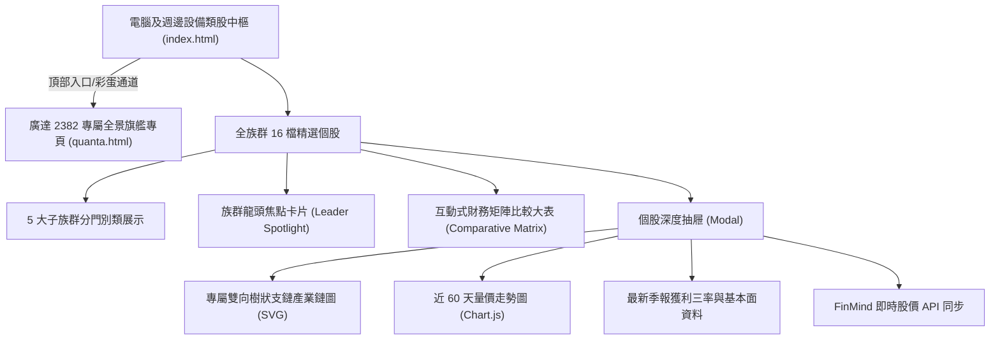

# 台灣電腦及週邊設備類股與廣達 AI 產業鏈中樞 —— 專案全景交接記憶檔 (Project Memory & Handover)

> **產生時間**：2026-11-26  
> **最後更新**：2026-11-26（新增籌碼面三大法人分析、K 線圖切換、盤中即時報價、還原股價）  
> **專案狀態**：已完成全部核心功能開發並成功部署上線  
> **適用對象**：接手的 AI 助手（如 Claude）、開發者或專案維護人員

---

## 1. 專案核心基本資訊

- **本地工作目錄**：`c:\Users\User\Desktop\0923\quanta-ai-supply-chain`
- **GitHub 儲存庫**：`https://github.com/itachi923/quanta-ai-supply-chain.git`
- **主要分支**：`main`
- **GitHub Pages 線上展示網址**：
  - 💻 **首頁（電腦及週邊設備類股中樞）**：[https://itachi923.github.io/quanta-ai-supply-chain/](https://itachi923.github.io/quanta-ai-supply-chain/)
  - 🤖 **廣達旗艦專頁（廣達 2382 全景深度研究）**：[https://itachi923.github.io/quanta-ai-supply-chain/quanta.html](https://itachi923.github.io/quanta-ai-supply-chain/quanta.html)

---

## 2. 專案背景與架構全景

本專案旨在打造台灣加權指數 **「電腦及週邊設備類股（TWSE 04）」** 的權威級產業鏈地圖與投資分析中樞，以純前端（HTML5 / 原生 CSS / 原生 JavaScript / SVG / Chart.js）打造，零後端依賴，完全託管於 GitHub Pages。

### 雙核心頁面體系：



1. **`index.html`（電腦及週邊設備類股中樞）**：
   - **全球戰略地位看板**：四大全球制霸數據（AI伺服器代工 >90%、筆電製造 >80%、導軌專利 >80%、水冷模組全球首位）與台灣代工演進史。
   - **5 大子族群分門別類**：
     1. `odm`：AI 伺服器整機與系統代工（廣達、鴻海、緯創、緯穎、英業達、和碩）
     2. `components`：伺服器關鍵零組件與散熱（奇鋐、雙鴻、川湖、勤誠）
     3. `ipc_iot`：工業電腦與邊緣物聯網（研華、樺漢）
     4. `brand_pc`：電腦品牌與電競旗艦（華碩、微星）
     5. `peripherals`：週邊設備與智慧顯示（佳世達、致伸）
   - **族群領軍龍頭（Bellwether）焦點卡片**：廣達（2382，代工龍頭）、川湖（2059，導軌霸主）、奇鋐（3017，散熱總冠軍）、研華（2395，工控龍頭）、華碩（2357，品牌旗艦）。
   - **多維度財務矩陣比較大表**：支援依股號、族群、股價、漲跌幅、近四季 EPS、單季營收、毛利率、營業利益率、ROE 即時點擊排序與子族群篩選。
   - **個股深度彈窗（Modal）**：點選 16 檔任一檔股票，即展開**該股專屬的雙向樹狀支鏈產業鏈圖**、近 60 天歷史量價線圖、財務指標，並即時連線更新。
   - **量價圖 K 線切換**：每檔個股彈窗的 60 日量價圖支援「收盤線圖 ⇄ K 線圖」切換，
     K 線模式疊加 MA20 月均線，價格面板與成交量面板上下分離（不使用雙軸），成交量柱色與 K 棒同步。
   - **籌碼面區塊（Institutional Chips）**：每檔個股彈窗下方附三大法人買賣超與外資持股分析 —— 6 張摘要數字卡、三大法人每日買賣超堆疊柱狀圖、外資持股比例走勢圖、可切換的數據表格，並支援近 20／40／60 日區間切換。

2. **`quanta.html`（廣達 2382 旗艦專頁）**：
   - **頂部動態 Ticker**：即時股價、漲跌點數、漲跌幅、本益比、成交量、成交金額、總市值。
   - **章節 1：基本資料與產品營收拆解**：林百里/梁次震創辦、華亞園區總部、QCT 雲達白牌直供模式；AI伺服器(55%)、筆電(32%)、車用電子(9%)、智慧醫療(4%)。
   - **章節 2：700+ 個交易日歷史日線與均線**：支援「收盤線圖 ⇄ K 線圖」切換，近1個月、3個月、6個月、1年、全週期過濾，自動計算 MA20 月線與 MA60 季線。
     價格面板與成交量面板上下分離（已於 2026-11-26 由雙軸改為雙面板），兩面板 Y 軸等寬以對齊日期軸。
   - **章節 3：最新財報基本面與獲利三率**：單季突破 1.1 兆元、累計四季度 EPS 突破 25.76 元、歷年營收/EPS長條圖、獲利三率（毛利率 8.72%、營益率 5.25%、淨利率 4.40%）三率三升折線圖。
   - **章節 4：全景樹狀支鏈產業鏈拓撲圖**：五層橫向雙向拓撲（上游葉子 11 家 -> 上游模組 6 大類 -> 中游 6 大代工廠 -> 下游 2 大應用 -> 下游 CSP 與終端巨頭 6 家），支援縮放平移、節點高亮關聯路徑、側欄 Inspector 詳解。
   - **章節 5：AI 伺服器機櫃 BOM 表成本結構**：運算模組(GPU/CPU 68%)、水冷散熱(12%)、高階電源(7%)、高多層PCB/CCL(5%)、專利導軌機箱(4%)、高速纜線(4%)。
   - **章節 6：籌碼面 —— 三大法人動向與外資持股結構**：6 張摘要數字卡、依實際數據自動生成的籌碼結構解讀（可辨識「外資提款、投信承接」等對作格局）、三大法人每日買賣超堆疊柱狀圖、外資持股比例走勢圖、數據表格，支援近 20／40／60／全區間（80 日）切換。
   - **章節 7：投資價值總評與催化劑**：四大上行催化劑與風險防範指引（原章節 6）。

---

## 3. 專案檔案結構

```
c:\Users\User\Desktop\0923\quanta-ai-supply-chain\
├── index.html                      # 主頁：電腦及週邊設備類股中樞 (約 92 KB)
├── quanta.html                     # 旗艦專頁：廣達 (2382) 深度基本面與拓撲圖 (約 77 KB)
├── README.md                       # 專案說明文件
├── PROJECT_MEMORY.md               # 本交接記憶檔
├── .gitignore                      # 忽略 desktop.ini / __pycache__ / .claude
├── .github/
│   └── workflows/
│       └── realtime-quotes.yml     # 每 5 分鐘抓 MIS 盤中報價，推到 data-live 分支
├── data/
│   ├── quanta_latest.json          # 廣達 700+ 筆歷史量價快取 (2024~最新)
│   ├── sector_stocks.json          # 16 檔精選股票完整資料庫（基本面、產業鏈樹狀節點、60天日線）
│   ├── institutional.json          # 16 檔近 80 個交易日三大法人買賣超 + 外資持股比例 (約 151 KB)
│   └── realtime.json               # 盤中報價快照（後備用；線上主要讀 data-live 分支）
└── scripts/
    ├── build_sector_data.py        # 建構/更新 16 檔類股資料庫腳本 (串接證券 API，已改為保留 treeChain)
    ├── build_institutional_data.py # 建構/更新 16 檔籌碼面資料庫（三大法人 + 外資持股）
    ├── fetch_realtime_quotes.py    # 抓證交所 MIS 盤中即時報價，產出 realtime.json
    ├── adjust_splits.py            # 還原股價：偵測並回溯調整股票分割造成的價格斷層
    ├── enrich_tree_chains.py       # 為 16 檔個股注入精緻專屬產業鏈拓撲資料
    ├── update_sector_subgroups.py  # 更新 5 大子族群分組與龍頭標記
    └── update_stock.py             # 更新廣達最新日線資料
```

---

## 4. 關鍵技術架構與避坑防護 (Crucial Technical Notes)

接手開發時，請**務必遵守**以下已驗證的重要工程規範：

### 1) 數字與幣別絕不換行（No-Wrap & Non-Breaking Space）
- **痛點**：之前在卡片或表格中，`NT$` 與數字（如 `44.35`）會因為容器壓縮被自動斷行成上下兩行。
- **解法規範**：
  - CSS 中所有涉及價格與金額的元素皆設定 `white-space: nowrap !important; word-break: keep-all; flex-shrink: 0;`。
  - JS 模板字串中一律使用 `NT$&nbsp;${price}` 與 `${symbol}${spread}&nbsp;(${pct}%)`，不可使用一般空格。

### 2) SVG 樹狀支鏈圖文字寬度自適應（Anti-Overflow Engine）
- **痛點**：節點文字過長（如「高階PCB與材料」或公司代號）容易超出矩形框框。
- **解法規範**：
  - 在繪製 SVG text 前，呼叫 `getFittedFontSize(text, maxWidth, defaultSize)` 動態測算文字寬度並調整字號（下限 9px），確保文字永不超出節點外框。
  - 連接線一律使用平滑三次方貝茲曲線（Cubic Bézier Curve: `M x1 y1 C ... x2 y2`），靜態高亮無重繪抖動。

### 3) 報價架構：盤中即時報價 + 日線快取（重要，曾經搞錯過）

> ⚠️ **先釐清一個曾經寫錯的觀念**：FinMind 的 `TaiwanStockPrice` **只有日線收盤資料，不是即時報價**。
> 盤中以當日日期查詢會回傳 **空陣列**。
> 2026-11-26 之前的版本到處寫「即時股價」，實際顯示的一直是 **前一交易日收盤價**。
> 當日 11:50 實測：網站顯示廣達 261.0（11/25 收盤），真實盤中價為 281.0。

- **真正的即時來源**：證交所 MIS `https://mis.twse.com.tw/stock/api/getStockInfo.jsp`
  - 支援一次批次查詢多檔：`ex_ch=tse_2382.tw|tse_3231.tw|...`
  - **3324 雙鴻為櫃買股，必須用 `otc_` 前綴**，用 `tse_` 會回傳空白紀錄。
  - **價格取值順序**：盤中逐筆撮合下頂層 `z` 多半是 `"-"`，必須依序退回
    `z` → `trade.z`（最近一筆成交價）→ `b` 委買首檔 → `o` 開盤價。
  - 其他欄位：`y` 昨收、`v` 累積成交張數、`u`/`w` 漲跌停價。MIS **不提供成交金額**，只能估算。
- **致命限制：MIS 不送 CORS 標頭**，瀏覽器從 GitHub Pages 直接呼叫一定被擋。
  Yahoo Finance 的 `query1.finance.yahoo.com` 同樣沒有 CORS 標頭；
  FinMind 的即時快照端點 `taiwan_stock_tick_snapshot` 需付費等級。
  **結論：沒有任何免費又支援 CORS 的台股即時 API 可供靜態網站直連。**
- **解法（零後端，繞開 CORS）**：
  1. GitHub Actions（`.github/workflows/realtime-quotes.yml`）每 5 分鐘執行
     `scripts/fetch_realtime_quotes.py`，抓 MIS 報價存成 `realtime.json`。
  2. 快照以 **孤兒分支強制覆蓋** 推到 `data-live` 分支（永遠只有一個提交，
     不污染 `main` 歷史、也不會觸發 Pages 重新建置）。
  3. 前端從 `https://raw.githubusercontent.com/.../data-live/realtime.json` 讀取 ——
     **`raw.githubusercontent.com` 有 `Access-Control-Allow-Origin: *`（已實測）**，可跨域直連。
- **三層後備**：`data-live` 快照 → 專案內 `data/realtime.json` → FinMind 日線收盤。
  任何一層失敗都靜默退到下一層，畫面不會壞掉。
- **誠實標示**：畫面一律顯示快照自帶的 `marketDate` / `marketTime`
  （例如「報價時間 2026-11-26 11:55:36（證交所 MIS）」），而不是一律寫「即時」。
  Actions 的 cron 本身有數分鐘誤差，使用者看得到實際報價時間才不會被誤導。
- **首屏秒開仍然保留**：先用 `data/sector_stocks.json` 與 `data/quanta_latest.json`
  渲染日線與圖表，再於背景以報價快照覆寫價格欄位。

### 3-1) 還原股價（股票分割回溯調整）

- **痛點**：FinMind 與 TWSE 的原始價格皆為 **未還原**。個股一旦分割，
  K 線會出現假斷崖，均線與報酬率全部失真。
- **已知案例**：**緯穎 (6669)** 於 2026-09-02 由 7,800 跳到 2,610
  （-66.5%、比值 2.989 ≈ 1:3、成交量放大 3.81 倍）→ 判定為 **1:3 股票分割**。
  調整後最大單日跳動收斂為 9.94%（正常漲停）。
- **對照組**：**川湖 (2059)** 同期 14,340 → 6,505 **無單日斷點**，
  屬真實連續下跌，偵測器不會誤判調整。
- **偵測條件（三者必須同時成立）**：單日變動 > ±25%、價格比值接近常見分割倍數（誤差 4% 內）、
  成交量同步往相反方向放大／縮小。實作於 `scripts/adjust_splits.py`，
  已內嵌到 `build_sector_data.py` 與 `update_stock.py`，重跑不會還原回未調整狀態。
- **可追溯**：調整後會在個股資料寫入 `"splits": [{"date":..., "factor":..., "kind":...}]`。
- **先 dry-run 再套用**：`python scripts/adjust_splits.py` 只報告，加 `--apply` 才寫檔。

### 4) 籌碼面資料管線與圖表設計準則

- **資料來源**（FinMind，皆免 token、開放 CORS）：
  - `TaiwanStockInstitutionalInvestorsBuySell`：三大法人每日買賣張數
  - `TaiwanStockShareholding`：外資持股比例（`ForeignInvestmentSharesRatio`）
- **法人分類對應**（FinMind `name` 欄位 → 台股慣用三大法人）：
  - 外資 = `Foreign_Investor` + `Foreign_Dealer_Self`
  - 投信 = `Investment_Trust`
  - 自營商 = `Dealer_self` + `Dealer_Hedging`
  - 單位一律 **(buy − sell) ÷ 1000 = 張**，正數買超、負數賣超。
- **API 額度注意**：FinMind 免費額度有限，連續呼叫會回 `HTTP 402 Payment Required`（實為限流）。
  **注意**：被限流時的錯誤回應 **不帶 `Access-Control-Allow-Origin` 標頭**，因此瀏覽器 Console 會顯示成
  「blocked by CORS policy」而非 402 —— 這是限流的表徵，不是程式缺陷，頁面會自動回退本地快取照常顯示。
  `build_institutional_data.py` 已內建退避重試（最多 3 次，間隔遞增）與每次呼叫 1.2 秒間隔，
  前端則只在開啟彈窗時補抓「近 12 天」補尾，失敗一律 **靜默回退本地快取**，不影響其他區塊。
- **圖表設計準則（新增圖表時務必遵守）**：
  1. **絕不使用雙數值軸**。買賣超（張）與持股比例（%）各自獨立成圖——兩個尺度疊在同一張圖會製造出資料中不存在的假相關。
  2. **類別色固定順序、永不循環**：外資 `#2a78d6`（藍）、投信 `#eb6834`（橘）、自營商 `#1baf7a`（碧綠）。此三色已通過色盲安全性驗證。
  3. **顏色只承載「身分」**；多空方向由零軸上下位置與 ▲▼ 文字承載，絕不以顏色單獨表意。
  4. 髮絲實線格線（`#f1f5f9`，零軸 `#94a3b8` 略深），不使用虛線；堆疊段之間以表面色（白）描邊製造留白。
  5. 每張圖都有圖例或標題指名，並提供可切換的 **數據表格視圖**（不靠顏色與游標即可讀取每個數值）。
  6. 摘要數字卡使用 **比例數字**（`--font-main`），表格才用等寬數字（`tabular-nums`）。
  7. 區間濾鏡列統一置於所有圖表 **上方**，一次切換連動數字卡、兩張圖與表格。

### 5) K 線圖實作與 Chart.js 三個必踩的坑

- **K 棒不需要任何額外函式庫**：以 Chart.js 原生 **浮動長條** 繪製即可 ——
  影線 = `[最低, 最高]`、實體 = `[開盤, 收盤]`，兩個 dataset 皆設 `grouped: false` 使其疊在同一根 x 上。
  台股慣例：紅 K = 收盤 ≥ 開盤、綠 K = 收盤 < 開盤。
- **坑 1：bar 型態的 Y 軸預設含 0**。價格軸若不明確指定 `min` / `max`，
  Chart.js 會把 0 納入軸範圍，K 棒會被壓縮在圖表上方一小塊、完全看不出型態。
  解法：依資料的最高／最低價加約 6% 留白後，再依價位高低取整到合適級距
  （>500 用 50、>100 用 10、>20 用 5、>5 用 1、其餘 0.5），讓刻度是整齊數字。
- **坑 2：在 `display:none` 的容器中建立圖表，寬度為 0**。
  `openStockModal()` 必須 **先** 把彈窗設為 `display:flex`，**再** 呼叫繪圖函式，
  否則 K 棒會縮在畫布左上角一小塊。（樹狀圖的文字寬度測算同理需要元素可見。）
- **坑 3：靠 canvas 的 `height` 屬性維持長寬比，在手機寬度下會把面板壓扁**。
  成交量面板在 375px 寬時只剩約 40px，扣掉軸標籤後柱子幾乎消失。
  解法：容器固定高度 + `maintainAspectRatio: false`，並以 media query 調整
  （桌機 300/118、手機 230/100；彈窗為 260/96 與 220/92）。
- **十字線處理**：開盤 = 收盤時浮動長條高度為 0 會消失，需給予極小 epsilon 高度保留一條橫線。
- **對齊**：價格面板與成交量面板以 `afterFit` 固定相同的 Y 軸寬度，日期軸才會逐日對齊；
  日期刻度只在下方成交量面板顯示，價格面板設 `ticks.display: false`。

### 6) 資料腳本的破壞性寫入防護（重要）

- **痛點**：`build_sector_data.py` 原本是把內嵌的 `STOCKS_CONFIG` 整份 `json.dump` 覆寫 `sector_stocks.json`，
  但 `treeChain`（16 檔個股專屬樹狀產業鏈圖資料）是由 `enrich_tree_chains.py` **事後注入 json** 的，
  不存在於 `STOCKS_CONFIG` 裡。因此每跑一次更新報價，就會**無聲洗掉全部 16 檔的樹狀圖**。
- **解法規範**（已於 2026-11-26 修正）：
  1. 寫入前先讀回既有 `sector_stocks.json`，把設定檔沒有的欄位（`treeChain` 等）合併回來。
  2. 寫入前自我檢查，若任一檔缺少 `treeChain` 則**中止寫入**並提示先跑 `enrich_tree_chains.py`。
  3. 抓取失敗時沿用既有報價，絕不寫入空值。
- **接手守則**：任何「整份重寫 data/*.json」的腳本，都必須先合併既有欄位再寫入。

### 7) Git 與 GitHub Pages 發布工作流
- 遠端遠址：`https://github.com/itachi923/quanta-ai-supply-chain.git`
- 只要推送至 `main` 分支，GitHub Actions 會在約 30~60 秒內自動建置並部署至 GitHub Pages。

---

## 5. 歷史需求與疊代歷程清單 (User Requests History)

1. **最初需求**：做一個以廣達為核心的網站，呈現廣達產業上下游供應鏈。
2. **形式調整**：要求改為「樹狀支鏈圖」，點擊任一廠商可清晰查看整個產業鏈上下游。
3. **體驗優化**：
   - 解決滑鼠懸停節點時畫面劇烈抖動的問題（改為純 CSS transition 靜態高亮）。
   - 修正「高階PCB與材料」文字超出外框的問題（導入字體動態適配縮放）。
   - 在中游將與廣達同性質的代工同業（鴻海、緯創、緯穎、英業達、技嘉）一併完整列出。
4. **廣達深度旗艦化**：加入廣達公司簡介、創辦人、核心產品結構（AI機櫃佔55%）、股價、歷史量價線圖、最新財報獲利三率三升分析。
5. **數據真實與每日更新**：串接台灣證券資料庫真實數據（收錄 700+ 個交易日完整日線），支援每日自動更新最新收盤價與均線。
6. **升級為類股中樞門戶**：將網站擴大為「電腦及週邊設備類股」，首頁展示 16 檔核心個股列表、簡介、即時股價、專屬上下游與財報，並在頂部設置一鍵直達廣達旗艦專頁的按鈕。
7. **全個股產業鏈一致化**：要求 16 檔股票點進去的彈窗，上下游產業鏈圖必須做得跟廣達一樣精緻（皆為雙向樹狀拓撲圖）。
8. **文字超出外框全面修正**：對全部 16 檔個股彈窗產業鏈圖進行節點寬度與字體自適應調整，徹底解決溢出問題。
9. **深度族群導航與比較矩陣**：
   - 最上方加入類股詳細介紹與全球戰略地位四大數據。
   - 將 16 檔股票細分為 5 大子族群分門別類展示。
   - 新增族群領軍龍頭（Bellwether）焦點卡片（標記廣達、川湖、奇鋐、研華、華碩為何是龍頭）。
   - 新增互動式財務指標綜合比較大表（支援排序、篩選、毛利高低顏色高亮）。
13. **盤中即時報價與還原股價**（本次新增）：
    - 使用者回報股價與自行查詢不符 —— 查證後確認 FinMind 只有日線收盤，
      網站一直顯示前一交易日收盤價，「即時」是錯誤標示。
    - 改以證交所 MIS 為真實來源，透過 GitHub Actions + `data-live` 分支繞開 CORS。
    - 廣達專頁頂部 Ticker 與首頁 16 檔卡片／比較矩陣全部改為盤中報價。
    - 導入 `adjust_splits.py` 還原股價，修正緯穎 1:3 分割造成的假斷崖。

12. **K 線圖切換**：
    - `quanta.html` 章節 2 與 `index.html` 個股彈窗皆支援「收盤線圖 ⇄ K 線圖」切換。
    - 以 Chart.js 原生浮動長條繪製 K 棒，不引入任何新函式庫。
    - 量價圖由原本的雙軸改為「價格面板 + 成交量面板」上下分離，避免雙軸造成的假相關。

11. **籌碼面三大法人分析**：
    - 建立 `build_institutional_data.py` 抓取 16 檔個股近 80 個交易日的三大法人買賣超與外資持股比例。
    - `index.html` 每檔個股彈窗新增籌碼面區塊；`quanta.html` 新增章節 6 籌碼面專章（含自動數據解讀）。
    - 導入圖表設計準則：拆成兩張單軸圖（絕不雙軸）、類別色固定順序、附數據表格視圖。

10. **數字跑版與全即時連線**：
    - 徹底修正截圖中 `NT$` 與價格斷成兩行的跑版 bug。
    - 實現每一檔股票點進去線圖與股價均為最新，並配置即時自動更新與 60 秒定時輪詢功能。

---

## 6. 後續可考慮之擴充建議 (Roadmap Ideas)

若使用者後續提出新需求，接手助手可參考以下方向：
1. ~~**籌碼面分析**：外資、投信三大法人買賣超數據與持股比例圖表。~~ ✅ **已於 2026-11-26 完成**
2. ~~**K 線型態切換**：在 Chart.js 或引進 Lightweight Charts 支援「蠟燭 K 線圖 + 成交量」。~~ ✅ **已於 2026-11-26 完成**（以 Chart.js 原生浮動長條實作，未引入新函式庫）
3. ~~**還原股價（除權息／股票分割調整）**~~ ✅ **已於 2026-11-26 完成**（`scripts/adjust_splits.py`）
   - 尚未處理 **除權息** 造成的價格缺口（現金股利與配股）。目前只處理股票分割。
     除權息缺口通常小於 25%，不會被現行偵測器捕捉，長期報酬率仍會略微失真。
     若要完整還原，需另接 `TaiwanStockDividend` 資料集計算還原因子。
4. **匯出功能**：將個股產業鏈拓撲圖匯出為 PNG / SVG 圖片供報告使用。
5. **類股指數大盤對照**：加入「電腦及週邊設備指數（IX0026）」與大盤加權指數的強弱度對比走勢。
